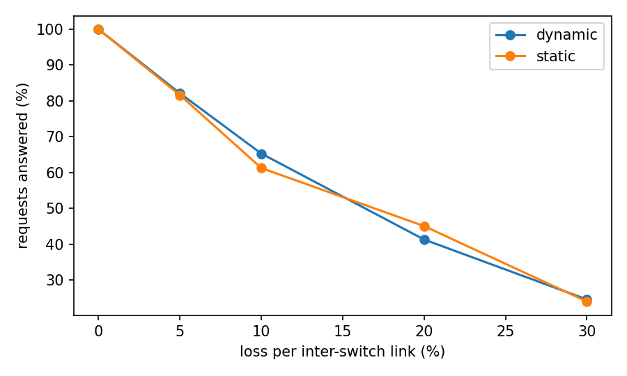
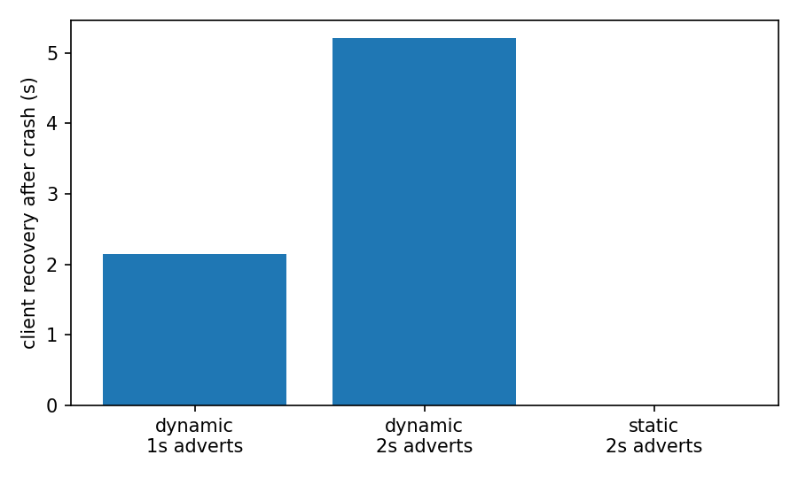

# Experiment results

## E1 Server crash: detection and client recovery

| mode | advert interval (s) | runs | controller detects (s) | client recovery (s) | requests answered (%) |
|---|---|---|---|---|---|
| dynamic | 1.0 | 1 | 2.15 | 2.14 | 95.5 |
| dynamic | 2.0 | 1 | 5.21 | 5.21 | 90.6 |
| static | 2.0 | 1 | n/a | no recovery | 42.1 |

## E2 Link failure on the primary path

| mode | runs | mean outage (s) | worst outage (s) | requests answered (%) |
|---|---|---|---|---|
| dynamic | 1 | 0.50 | 0.50 | 100.0 |
| static | 1 | never recovered | never recovered | 47.1 |

## E3 Packet loss sweep (loss on each inter-switch link)

| loss (%) | mode | runs | requests answered (%) | registry expiries (3 clients) | controller false removals |
|---|---|---|---|---|---|
| 0 | dynamic | 1 | 100.0 | 0.0 | 0.0 |
| 0 | static | 1 | 100.0 | 0.0 | 0.0 |
| 5 | dynamic | 1 | 82.1 | 0.0 | 0.0 |
| 5 | static | 1 | 81.6 | 0.0 | 0.0 |
| 10 | dynamic | 1 | 65.3 | 3.0 | 0.0 |
| 10 | static | 1 | 61.2 | 0.0 | 0.0 |
| 20 | dynamic | 1 | 41.3 | 0.0 | 0.0 |
| 20 | static | 1 | 45.0 | 0.0 | 0.0 |
| 30 | dynamic | 1 | 24.5 | 0.0 | 0.0 |
| 30 | static | 1 | 24.0 | 0.0 | 0.0 |

## E4 Control plane overhead

| advert interval (s) | servers | adverts sent (approx) | advert packet-ins | all packet-ins | flow-mods | adverts kept off controller (%) |
|---|---|---|---|---|---|---|
| 1.0 | 1 | 33 | 3 | 135 | 34 | 90.9 |
| 1.0 | 2 | 66 | 4 | 129 | 42 | 93.9 |
| 1.0 | 3 | 99 | 5 | 136 | 50 | 94.9 |
| 2.0 | 1 | 16 | 3 | 128 | 34 | 81.2 |
| 2.0 | 2 | 33 | 2 | 132 | 42 | 93.9 |
| 2.0 | 3 | 50 | 9 | 136 | 50 | 82.0 |

The comparison baseline is a controller that handles every advert itself, which costs one packet-in per advert. That figure is computed from the number of adverts sent, not measured separately.

